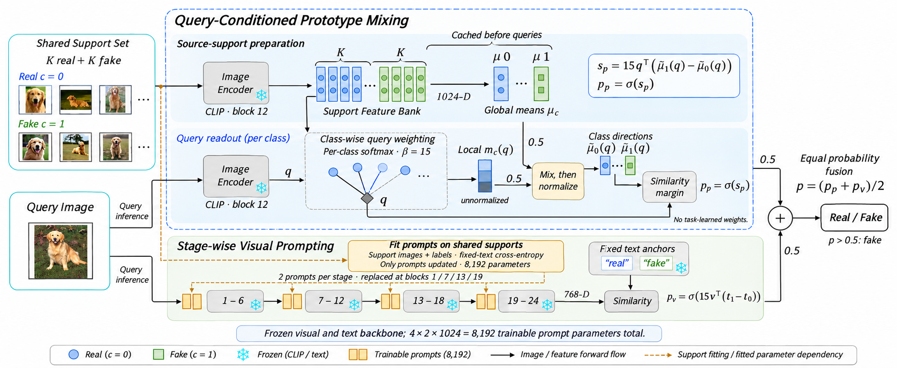

# 论文方法框架图 v4

当前为待确认的修订草稿。点击下图可打开 PNG 原图（1956 × 804）。

图中包含两个方法模块：

- **Query-Conditioned Prototype Mixing（查询条件化原型混合）**：根据 query 对类内支持特征加权，并与全局类中心混合后归一化。
- **Stage-wise Visual Prompting（分阶段视觉提示）**：四个阶段各使用两枚提示，在阶段切换时替换；仅用共享支持图像和标签训练 8,192 个提示参数。

两分支共用同一批支持样本，query 分别进入两条推断路径，最终进行等权概率平均。没有独立静态原型分支。

该草稿通过 image_gen 参考图编辑生成，以交接包 v3 为参考；不表示逐像素保留或最终发表质量已验收。
