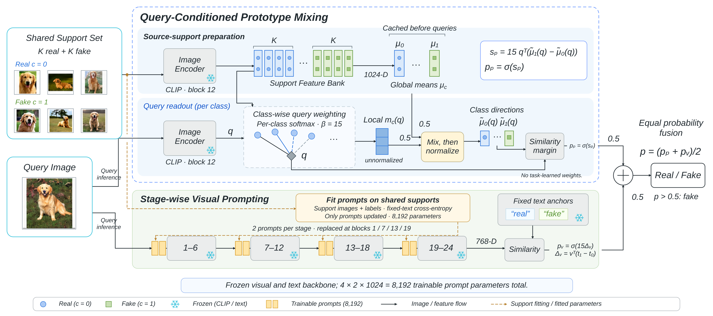

# Visio 可编辑框架图：兼容修订版 v2

上一版曾被用户的 Microsoft Visio 提示损坏。原先 ZIP 内含同一份旧文件，请改用本次新命名的兼容版。

- [优先尝试：VDX 兼容格式](framework-visio-compatible-v2.vdx)
- [VSDX 兼容修订版](framework-visio-compatible-v2.vsdx)
- [新版完整 ZIP 包](framework-visio-compatible-v2.zip)
- [SVG 备用](framework-editable.svg)
- [PNG 预览](framework-editable-preview.png)

下载原始文件到本地，在桌面版 Visio 中选择“文件 → 打开”。VDX 打开后可在 Visio 中另存为 VSDX，请不要只修改扩展名。

## 本次调整

VSDX 改用由 Visio 保存的完整文档骨架，保留完整样式、DocumentSheet、应用属性和窗口设置。删除了上一版不一致的一维端点/二维变换组合和跨对象粘连公式，连线保留为独立矢量折线。移动模块后，需要手动调整连线，不提供自动路由。

新增单文件 Visio XML（VDX）版本，绕开 OPC 压缩容器。它仍包含 220 个独立对象，其中 70 个文字对象、47 个线条对象及 7 张嵌入照片。兼容版不使用图层。

旧版失败的唯一根因尚未由 Microsoft Visio 的详细错误信息确认。上述属于有针对性的结构重建，不能描述为已经在微软 Visio 中成功打开。

## 验证范围

新版 VSDX 的主要 Visio XML 部件通过 Apache POI 所使用的公开 Visio Schema 校验；OPC 内容类型和关系文件通过对应 Schema 校验。ZIP CRC、部件引用和 XML 结构检查通过。

VSDX 与 VDX 均由 LibreOffice 的 Visio 导入器成功导入并导出单页 PDF；核对了两个方法名称、四个阶段、8,192 参数、7 张照片及矢量绘制记录。当前环境没有 Microsoft Visio，仍需在用户的本机版本确认。

上一版的第三方导入测试不足以证明微软 Visio 接受；本次修订明确保留该验证限制。下载大小和 SHA-256 记录在 editability-report.json 中。

## 可以编辑什么

仅包含查询条件化原型混合与分阶段视觉提示两个方法。两个 Encoder 等宽，四个阶段框为圆角矩形，雪花、token、特征符号和箭头为矢量。文字和公式按文本编辑，照片可移动、缩放或替换。VDX 中少数下标按普通文字显示，可以在 Visio 中调整。

两分支共用同一批支持样本，仅支持集训练 8,192 个提示参数；query 进入两条推断路径，最终固定等权融合。没有独立静态原型分支。

## 文件与源码

请优先使用带 v2 名称的文件，避免混淆本地旧下载。framework-editable.vsdx 也已更新为本次修订版；旧提交中的下载仍是旧文件。

完整包包含 VDX、VSDX、SVG、PNG、照片、对象记录、build_editable.py、visio_compat.py 和 support/。源码重新生成需要 Python、Pillow、Linux Liberation Sans 字体，并保留 assets/、support/ 和 PNG 预览。日常修改直接在 Visio 中完成即可。

support/visio-base.vsdx 来自开源 vsdx 0.6.1 附带的 Visio 模板，授权声明见 support/LICENSE-vsdx.txt；图中方法对象为本次重建内容。
