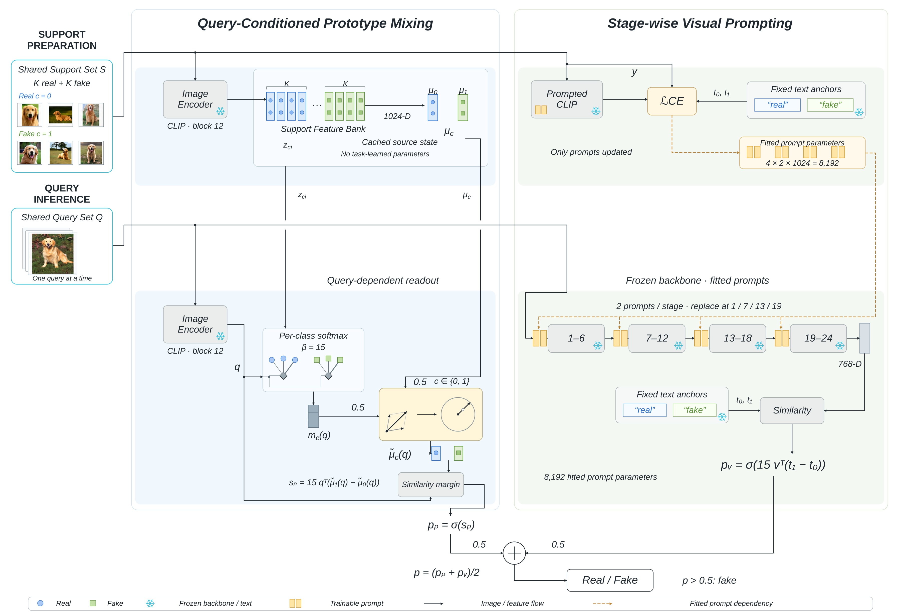
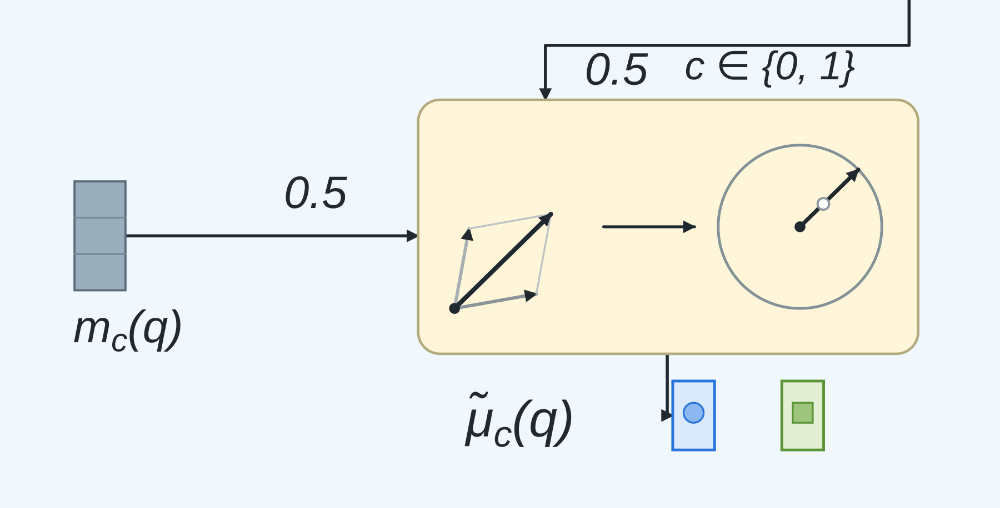

# 框架图 v5：两种方法 × 两个阶段

依据已确认的修改方案重排，供本轮审查。

- [查看全图 PNG](framework-v5.png)
- [查看混合与归一化局部放大图](framework-v5-mix-detail.png)
- [PDF 矢量预览](framework-v5.pdf)
- [可编辑文件包 ZIP](framework-v5-editable.zip)
- [SVG](framework-v5.svg) · [VDX](framework-v5.vdx) · [VSDX](framework-v5.vsdx)

## 本轮修改

1. 查询条件化原型混合与分阶段视觉提示改为左右两列。
2. 上半部为共享支持集准备，下半部为同一个 query 的两路推断；Support Set 与 Query Set 各只有一个输入框。
3. 两种方法的 support 和 query 输入均使用黑色实线。棕色虚线仅表示拟合提示参数及其向四个阶段提供的依赖。
4. 左侧缓存特征、全局类中心跨过 query 输入线时留有间隙；交叉处没有连接点。query 分叉点另有明确圆点。
5. 原 “Mix, then normalize” 框改为纯几何示意：两条灰色向量按平行四边形叠加，再沿相同方向延伸到单位圆。0.5 权重保留在输入边上。此操作分别作用于两个类别。
6. 全局类中心与未再次归一化的局部向量先混合，最后归一化；后续仍以真假类别方向之差形成原型分数。没有新增独立静态原型分支。
7. 分阶段提示保留四阶段替换规则、8,192 个参数、固定文本锚点及最终等权概率平均。

## 可编辑文件

包含 271 个独立对象，其中 74 个文字对象；7 张照片仍为可移动、可替换的位图。主要框、连线、图标和公式可分别修改。兼容版本保留独立矢量折线，不提供自动粘连和自动路由。

之前的 VSDX 曾被用户的 Microsoft Visio 提示损坏。v5 沿用完整 Visio 文档骨架的保守封装，并提供 VDX 和 SVG 备用。当前环境没有 Microsoft Visio，不声称已经在该软件实测；如需在 Visio 修改，可先尝试 VDX，打开后另存为 VSDX。

SVG、PNG 与 PDF 展示的是同一版图形。VDX 兼容格式中的部分下标可能按普通文字显示，可以在 Visio 中调整。

## 验证

VSDX 的主要 Visio XML 部件及 OPC 部件通过相应 Schema 校验。VSDX 与 VDX 都能由 LibreOffice/libvisio 导入并导出单页 PDF；核对了两个方法、两种共享输入、四个阶段、参数数目以及 7 张照片。混合框内部没有文字对象。

检查仅说明上述结构与导入结果，不代表用户审美验收。统计和验证范围见 v5-report.json。

## 重建

build_v5.py 定义本轮布局，vector_engine.py 负责 SVG/VSDX 对象输出，visio_compat.py 负责保守 VSDX 封装与 VDX 备用。需要 Python、Pillow、Inkscape，以及 Linux Liberation Sans 字体；保持 assets/ 和 support/ 相对位置后运行 python3 build_v5.py。

support/visio-base.vsdx 的许可见 support/LICENSE-vsdx.txt（BSD-3-Clause）。
