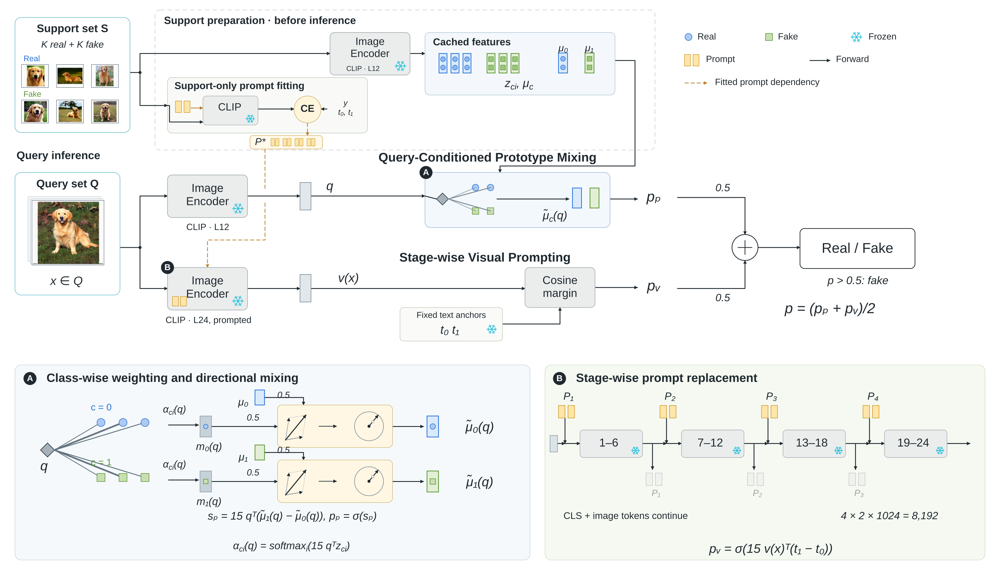

# 框架图 v6：主流程与局部机制

依据本轮提供的论文框架图重新构图，保留查询条件化原型混合与分阶段视觉提示两种方法。

- [高清全图 PNG](framework-v6.png)
- [矢量 PDF](framework-v6.pdf)
- [可编辑文件包 ZIP](framework-v6-editable.zip)
- [SVG](framework-v6.svg) · [VDX](framework-v6.vdx) · [VSDX](framework-v6.vsdx)
- [A：查询加权与方向混合](framework-v6-prototype-detail.png)
- [B：分阶段提示替换](framework-v6-prompt-detail.png)



## 构图变化

整体采用“紧凑推断主线 + 上方支持集准备 + 下方 A/B 机制详图”。借鉴 FTNet 的支持集预处理与查询推断区分、PPM-CLIP 的概览和局部机制分工，以及 Fleet 对中间特征和路由权重的图形化表达。没有引入参考论文中的额外算法。

同一个 support set S 分给特征缓存与提示训练。一个 query 在编码前分成两路，分别经过不带提示的 L12 特征提取，以及带已训练提示的完整 L24 前向。模块名使用正体，数学变量使用斜体；蓝色圆形和绿色方形始终分别代表 real 和 fake，黄色表示提示，青色雪花表示冻结。

A 详图展示同一个 q 对两类支持特征分别分配类内权重，形成 m₀(q)、m₁(q)，再各自与对应全局类中心等权混合。原来的“Mix, then normalize”文字操作框改为平行四边形向量相加和沿同一方向延伸到单位圆的几何示意，0.5 写在输入连线上。

B 详图展示两枚提示 token 在 blocks 1、7、13、19 处进入；旧的一对在下一对进入前退出，CLS 和图像 token 持续传递。A/B 标记只对应局部机制，不用额外数据线连接放大图。

## 方法约束

- S 包含 K 张 real 和 K 张 fake 的带标签图像，是两种方法共享的唯一来源。
- 原型路使用冻结 CLIP ViT-L/14 的 L12 CLS，支持特征和查询特征归一化。全局均值归一化；类内权重为 α_ci(q)=softmax_i(15qᵀz_ci)。
- 局部加权向量 m_c(q) 不先做二次归一化；先与 μ_c 按 0.5/0.5 混合，之后归一化得到 μ̃_c(q)。没有新增独立的静态原型分支，也没有学习融合权重或分类头。
- 提示路只在 S 的图像与标签上训练，CLIP 主干与文本编码器冻结。固定文本为 “a real photograph” 与 “an AI-generated image”。query 只前向，不用 query 标签或测试时更新。
- 每阶段两枚 1024 维 token，四组共 4×2×1024=8,192 个可训练参数；不是八枚同时累积。
- 两路分别输出真假方向差的 sigmoid 概率，最后 p=(pₚ+pᵥ)/2，p>0.5 判为 fake。

## 编辑与文件

本图有 318 个独立对象，其中 96 个文字对象。框、连线、向量、符号和数学文字可分别修改；公式下标使用独立的小文字对象，以保持跨软件位置；7 张照片保留为可移动、可替换的位图。Visio 版本使用独立矢量折线，未启用自动粘连与自动路由。

此前用户的 Microsoft Visio 曾将第一版 VSDX 提示为损坏。本版沿用实际 Visio 文档骨架的保守封装，并提供 VDX 与 SVG 备用。当前环境没有 Microsoft Visio，未在该软件中实测；建议先尝试打开 VDX，成功后另存为 VSDX。

## 验证范围

验证记录见 [validation/visio-validation.json](validation/visio-validation.json)。核查 VSDX 的主要 Visio XML 部件、OPC 结构和关系目标，并分别用 LibreOffice/libvisio 导入 VSDX 与 VDX 后导出 PDF。该检查不等同于 Microsoft Visio 兼容性实测。LibreOffice 26.8 的图像导入器会给照片附加默认绿色粗边，源 Visio 文件已明确关闭该描边；该软件限制记录在报告中。发布的 SVG、PNG 和 Inkscape PDF 保持预期的细灰色边框。

## 重建

保持 assets/ 与 support/ 的相对路径，安装 Python 3、Pillow、Inkscape 与 Liberation Sans 字体后运行：

```sh
python3 build_v6.py
inkscape framework-v6.svg --export-filename=framework-v6.pdf
```

build_v6.py 定义布局，vector_engine.py 输出可编辑对象，visio_compat.py 生成保守 VSDX 封装与 VDX。framework-editable.scene.json 保留对象级源数据。support/visio-base.vsdx 使用 BSD-3-Clause 许可，见 support/LICENSE-vsdx.txt。
