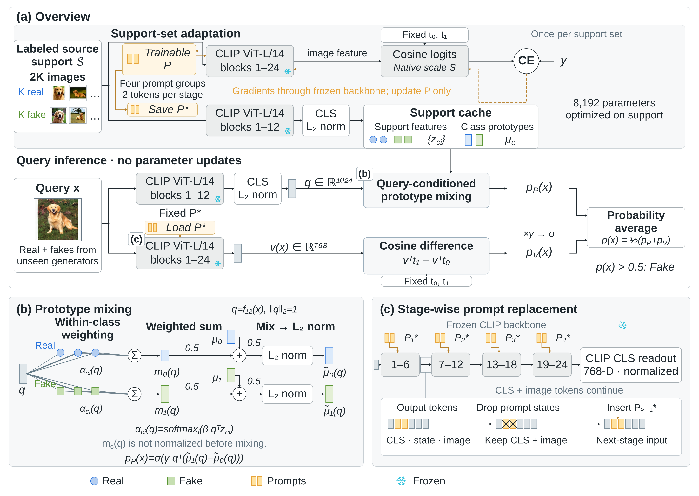

# v8：计算定义、跨生成器协议与印刷字号修订

本轮仅修订作者选定的这一张框架图，保留总览＋原型混合＋提示替换布局。

- **[查看最终主图 PNG](framework-v8.png)**
- **[下载可编辑文件包](framework-v8-editable.zip)**
- [SVG](framework-v8.svg) · [矢量 PDF](framework-v8.pdf) · [VDX](framework-v8.vdx) · [VSDX](framework-v8.vsdx)
- [中英文图注与完整公式定义](caption.md)
- [180 mm 物理尺寸 PDF](validation/print-180mm.pdf) · [字号检查](validation/print-180mm-check.md)
- [image_gen 视觉预览](imagegen-preview.png) · [绘图 skill 规格、生成过程与恢复包](framework-v8-skill-run.zip)

## 本轮落实

1. 支持与原型查询路径都明确画出块12后的CLS提取和L₂归一化。图注定义其位于最终LayerNorm/投影之前，q和z均为1024维FP32单位特征。
2. 主图直接写Labeled source support 𝒮、Query x、Real＋fakes from unseen generators，以及Query inference·no parameter updates。缓存与固定P*跨全部目标查询共享，查询标签不参与适配；每张query仍进行自己的条件化读出。
3. 缓存分为Support features {z_ci}和Class prototypes μ_c；图注给出μ_c=norm(mean_i z_ci)，不把它画成CE学习的参数或额外静态分类分支。
4. 明确四组提示、每阶段两枚token，参数量只标一次；用同款Save/Load P*状态端口，推理旁写Fixed P*。
5. b在权重连线近旁标α_ci(q)，两段加权连线保留对应线宽，并准确保留每类的0.5μ_c＋0.5m_c(q)与混合后归一化；m混合前不再次归一化。
6. c仅突出第一个阶段边界，对应一张token级局部图；删除重复大句、其他边界的重复丢弃符号和重复参数量。末端读出收为CLIP CLS readout /768-D·normalized。
7. 总览统一p_P(x)、p_V(x)；细节定义q=f₁₂(x)。β表示类内权重尺度、γ表示固定推理评分尺度，二者均为15；γ只是为原文已有固定15命名，不是新增学习参数。视觉分数明确vᵀt₁−vᵀt₀。训练原生S及γ/S关系、完整CLS读出顺序、otherwise Real等定义在图注中。
8. 合并训练反馈说明，删除重复文本以放大字号。物理PDF180×127.8mm；检查43组主要标签8.164–9.057pt，62组辅助文字基字号最低7.143pt。数学下标按自然比例缩小，未把下标当作独立辅助正文。

## 交付与验证边界

最终主图是依据修订规格精确编排的可编辑矢量稿，包含313个独立对象、130个文字对象和5张可替换照片。imagegen-preview.png是沿用绘图skill生成并定点修正的栅格视觉预览；两者来源分开，不声称SVG逐像素分解该栅格预览。

VSDX/VDX均已由LibreOffice/libvisio导入；检查了单页、5图、主要标签、数学下标及关系目标。11个Schema部件通过，Windows部件因所给XSD未声明根元素属于覆盖限制。Microsoft Visio未在当前环境实测；建议先打开VDX，成功后另存VSDX。LibreOffice26.8图片默认绿边问题与源绘图样式有别，具体见validation/visio-validation.json与README-editor.md。

正文方法依据来自交接原文、连线规范和提示源码；具体未知生成器名单及与源域的互斥关系仍应由实验表说明，本图按作者本轮明确协议绘制。

重建说明见README-editor.md。编辑包包含矢量文件、PNG/PDF、图注、重建代码、资产及检查报告；恢复包另外保存本轮skill输入、prompt/contract、三次生图事件lineage和唯一active预览，未经伪造历史S2阶段。
